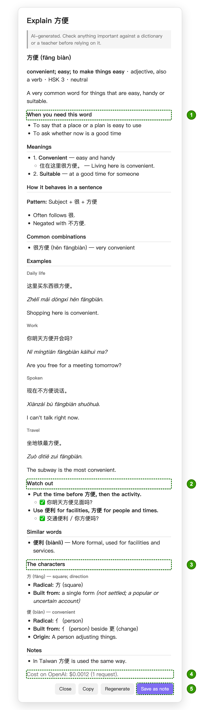
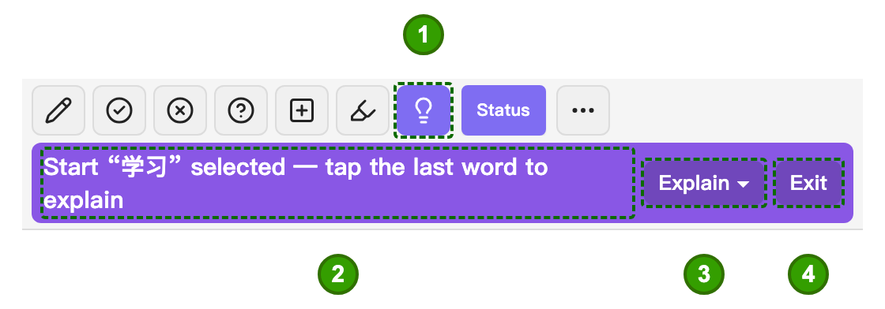
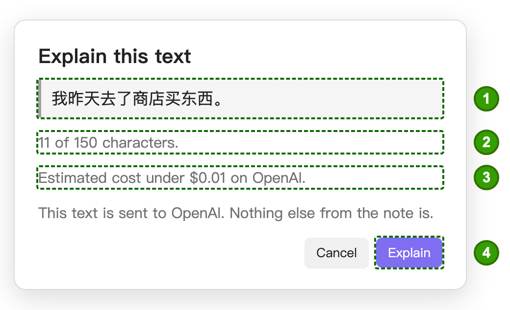
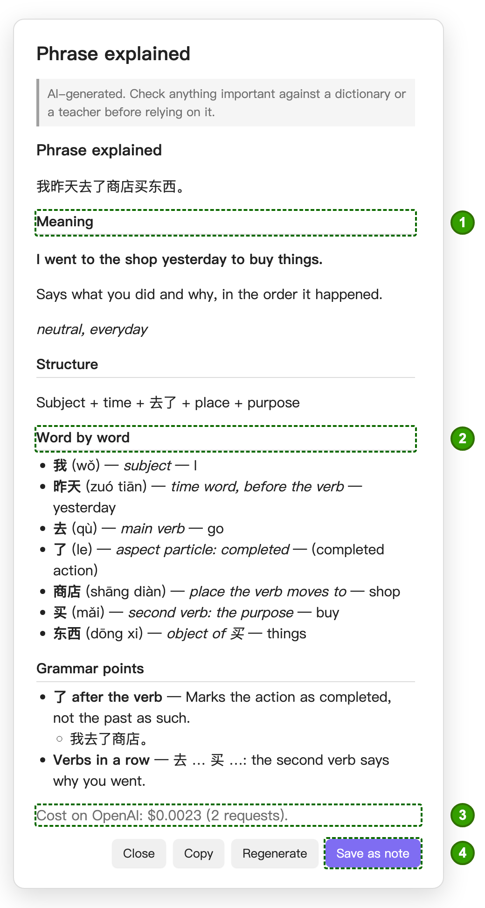
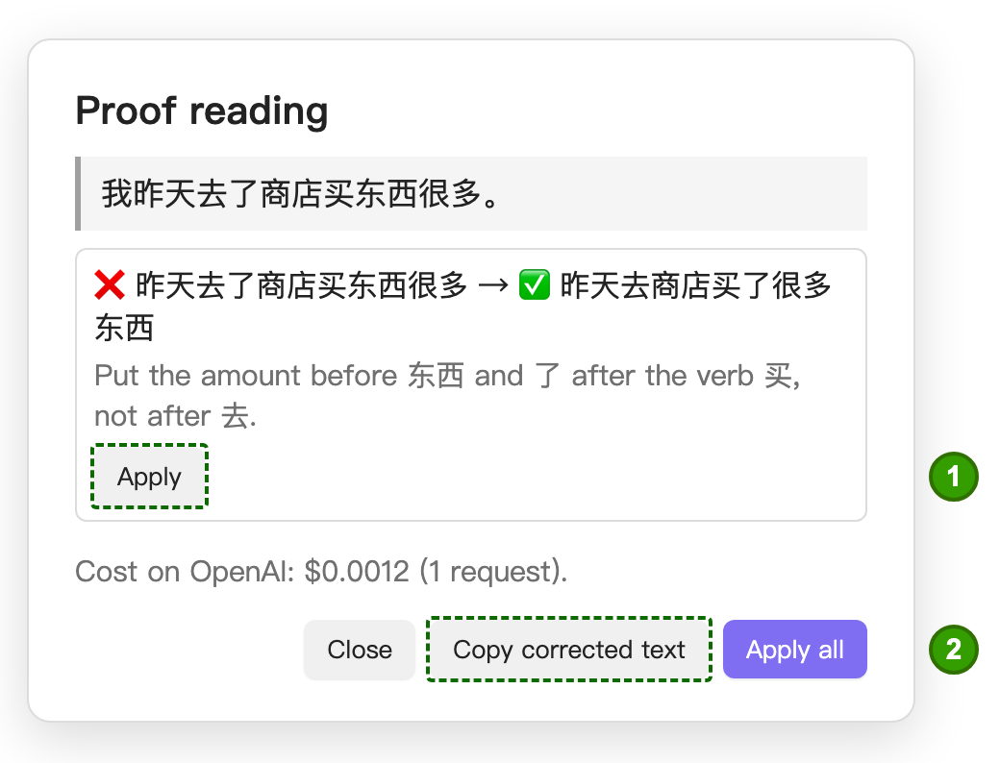

# Explain

**Explain** writes a thorough usage note for one word: not just the translation (the dictionary card and **Enhance**
already do that), but *when you need it, how to use it, how learners get it wrong, and what its characters are*. It shows the
note in a dialog first (with a progress bar while it is written, usually 20 to 40 seconds); nothing is saved to your vault until you press **Save**.

It appears on the word card as **Explain**, next to Mnemonic and Edit. If AI is not set up yet, pressing it explains what
is missing and takes you to the settings. It works with or without a sentence; if you opened the card from a sentence, that sentence is sent too so the model can pick the sense
you met (it still covers the other senses).

Beyond single words, the lightbulb tool [explains a phrase or sentence](#explaining-or-proof-reading-a-phrase-the-lightbulb), proof reads it, or [simplifies it](#simplify). Explain, Proof read and Simplify all need an AI provider and cost a fraction of a cent per answer on OpenAI.

## What is in a note

**1** *When you need this word*: concrete situations · **2** *Watch out*: a rule and the correct form · **3** *The characters*:
meaning and radical · **4** what it cost on OpenAI · **5** **Save as note** (next to Copy, Regenerate and Close).

Every note has the same layout, so it is easy to scan on a phone:

| Section | What it gives you |
|---|---|
| **At a glance** | The core meaning, part of speech, HSK level and register (neutral, spoken, formal…), then a short summary of why you need the word. |
| **When you need this word** | Two to four concrete situations ("To say that…"). |
| **Meanings** | Every sense, most common first, each with a short example. |
| **How it behaves in a sentence** | The sentence pattern, the measure word for a noun, and notes on position, negation, objects and complements. For particles and other function words this is written as a grammar point. |
| **Common combinations** | Frequent collocations and set phrases, with pinyin. |
| **Examples** | Five to eight natural sentences in different contexts and registers (daily life, work, spoken, formal), each with pinyin and English. |
| **Watch out** | Pitfalls that really trip learners up: a rule in one line and the correct form. Each is built from something the note already says (a confusion with a similar word, the sentence pattern, a habit carried over from English, or a register slip), and there may be none. |
| **Similar words** | Near-synonyms and easily confused words, and when to choose which. |
| **The characters** | For each character: its pinyin, its meaning, and its radical. The radical is looked up in Unicode's Unihan data by the plugin, not written by the AI. |
| **Notes** | Mainland vs Taiwan differences, politeness, frequency, related idioms. |

Example sentences are ordinary Chinese paragraphs in the note, so the plugin's reader annotates them like any other note
(colours, taps, popups).

## How reliable is it?

It is written by the AI model, so treat it like a good tutor's notes, not like a dictionary. The plugin does not give the
model free rein:

- **The facts come from your dictionary.** The pinyin, the HSK level, every dictionary reading and its meanings, and a
  line per character (using the reading *this* word has) are put in the request as ground truth.
- **The plugin checks what it can see.** Every example must contain the word, each pitfall needs its rule and the correct form, rows may not be half-filled, and there must be one entry per character. If a rule is
  broken the model is asked once more with the specific problem; if it is still wrong the dialog tells you what is off
  instead of hiding it.
- **It cannot check that a rule is true.** A note says so on its face: *AI-generated; check anything important against
  a dictionary or a teacher.*
- **Pitfalls are the weakest part.** Writing a realistic wrong sentence needs knowledge of real learner errors, which a
  model does not reliably have (in tests it often called fine Chinese wrong). So the note shows no wrong examples at
  all: only a short rule tied to the rest of the note and the correct form, and the section is left out rather than padded.
- **No made-up character stories.** How a character was built and where it comes from are not asked of the AI at all:
  models answer those from memory and small ones invent them (a local model once gave 的 the radical 阝 and a
  "grain pictograph" origin). The only structural fact shown is the **radical**, which the plugin looks up itself in
  Unicode's Unihan data; a simplified character shows the simplified form of its radical (讠 for 讲).

## Explaining or proof reading a phrase (the lightbulb)

The lightbulb button in the reader's toolbar (next to the highlighter) works on a stretch of text instead of one word.
Tap it, tap the **first word** of the text, then the **last word**. A dropdown in the banner chooses what happens:
**Explain**, **Proof read** or **Simplify**. The second tap opens a dialog that shows the text, its length and the likely cost, and
nothing is sent until you press the button there. **Exit** in the banner leaves the mode. With no AI set up, the button
tells you how to set it up instead of starting the mode.

The selection is limited (default 150 characters, about two or three sentences; **Settings → Explain & proof read → Longest
text**): more costs more and is explained worse. A longer selection is refused with the count, and you can simply tap an
earlier last word.

**1** the lightbulb, armed · **2** the hint (it names the word you tapped first) · **3** the dropdown: **Explain**, **Proof read** or **Simplify** ·
**4** **Exit**.

The confirm dialog: **1** the text that will be sent, **2** its length against the limit, **3** the estimated cost, **4** the button
that actually sends it.

### Explain

- **One word** selected: you get the normal word note described above.
- **Several words or sentences**: a quick, cheap check first asks whether the text is generally correct (it is lenient:
  spoken or informal Chinese is fine). Then comes the explanation, which is about the **big picture**, not a dictionary
  entry per word: a natural translation, what the text expresses and when you would say it, its sentence skeleton, a
  **word by word** list that gives every word's *grammatical job in this sentence*, the grammar points that make it work,
  and notes. The plugin checks that the list covers the whole selection, in order (nothing left out, nothing added) and
  asks once more if it does not.
- A **typo** is mentioned briefly in the note, and the words are explained as written.
- If the check says the text is **wrong** (so broken that an explanation would teach something false), the dialog says why and
  offers **Proof read this instead**; it does not explain wrong grammar.

**1** the translation and what it expresses · **2** *Word by word*: each word's job in this sentence · **3** the cost · **4** **Save as note**.

- Like the word note: preview first, then **Save as note** (same folder; `cci-explain-phrase` in its header), **Copy**
  or **Regenerate**.

### Proof read

It looks for real mistakes only (a wrong or missing character, a grammar slip, a wrong word or measure word, unnatural
word order, punctuation), not style. Each correction shows the wrong part, the fix, and a one-line reason. **Apply**
replaces that text **in your note** with one tap, **Apply all** does every one; **Copy corrected text** copies the whole
selection with the fixes. The corrected text is worked out by the plugin from the listed fixes, never taken from the model,
and a fix is written into the note only if the text there is still exactly what was shown (if the note changed while the
dialog was open, nothing is replaced and you are told to select again). Text that has formatting in the note (bold,
highlights, links) can still be applied when the wrong part itself is plain text; if the formatting runs through it, copy
the corrected text instead.

**1** **Apply** puts this one fix into your note · **2** **Copy corrected text** (beside it, **Apply all** applies every fix).

### Simplify

For a sentence that is too hard. The AI is asked for four to six different ways to say the **same thing** with easier
words and simpler grammar, in the same script as your text. **The AI does not decide which is simplest.** The plugin looks
every word of the original and of each rewrite up in the HSK lists and in your own vocabulary, and adds up how hard the
words are that you do not know yet (a word you marked known or ignored costs nothing). The rewrite with the lowest total
wins; ties go to the one whose hardest unknown word is easier, then to the one with fewer unknown words, then to the
shorter. It is proposed only if it is strictly simpler than your original; otherwise the dialog says the text is already
about as simple as it gets.

The result shows the original, the winner with the numbers behind it (*Words you don't know yet: 4 → 1 · Hardest of them:
HSK 5 → HSK 2*) and a one-line note from the AI on what the rewrite changes in meaning or tone, because a simpler sentence
can say something slightly different. The other rewrites are folded under **Other ways to say it**. **Apply** replaces your
selection in the note (only if the text there is still exactly what was selected; a selection that has formatting in the
note cannot be replaced, copy the text instead) and **Copy** copies one. Nothing is changed without a tap.

### Cost

Explaining a phrase makes two requests; proof reading and simplifying one each. The dialog shows an estimate before you start (OpenAI only;
a local model costs nothing) and the real cost afterwards, from the token usage the API reports. The word note shows its
real cost too.

## Saving, finding and regenerating

- **Save as note** writes `<word> <pinyin>.md` (so 行 xíng and 行 háng never collide) into **Settings → Explain & proof read →
  Folder** (default `Chinese Learning/Generated/Explanations`), and opens it in the reader if that setting is on.
- The note carries a small header (`cci-explain`, `cci-word`, the model, the prompt version, the date). The plugin finds
  a word's note through that header, so renaming or moving the note does not break it.
- If a word already has a note, Explain says so first and offers **Open it**; **Write a new version** generates again
  and saves beside the old one (`… 2.md`). **Nothing you wrote or edited is ever overwritten.**
- **Regenerate** in the dialog throws the preview away and writes a new one. **Copy** puts the Markdown on the clipboard.

## What is sent to the AI

**A word:** one request (plus at most one follow-up when a rule was broken): the word, its pinyin and traditional form, its HSK
level, its dictionary readings and definitions, one line per character (its pinyin and a short dictionary meaning), and
the sentence you opened the card from, if any. Nothing else from your vault is sent. With OpenAI this goes to OpenAI's
servers, with Ollama to your own; see [OpenAI setup, privacy, and cost](./openai-setup.md#2-privacy--your-text-leaves-obsidian).
A note costs a fraction of a cent to a few cents on OpenAI, depending on the model.

**A phrase or proof read** (the lightbulb): only the **selected text** is sent (with the note's formatting taken off), in two
requests for Explain (the quick check, then the explanation) and one each for Proof read and Simplify, plus at most one follow-up each when a
rule was broken. Nothing else from the note is sent, and the confirm dialog shows exactly what will go.

## Settings

**Settings → Explain & proof read** (a new group appears after a full restart of Obsidian):

- **Folder** — where saved notes go.
- **Open the note after saving** — in the reader.
- **Longest text to explain or proof read** — the limit for the lightbulb tool.
- **Advanced explain ▾ → Pinyin under example sentences** — the pinyin line under each example and combination.

## Telling the AI how you like things explained

**Settings → AI provider → AI prompts ▾** has one box per feature (Explain a word, Explain a phrase or sentence,
Proof read, Simplify). Whatever you write there is added to the end of the built-in prompt with every request, so it is the place
for "explain in German", "I am at HSK 3, keep it simple" or "I care about grammar more than vocabulary". The answer format
is still checked by the plugin, so an instruction cannot break the saved note. These words are sent to the AI provider
along with the text.

For full control, **Replace a whole prompt ▾** (inside the same page) replaces a built-in prompt with your own; **start
from the built-in prompt** copies ours into the box so you can edit it, and **go back to the built-in prompt** empties
it again. A replacement prompt must still ask for the JSON the plugin expects: if it does not, the plugin tries one
repair and then shows what is wrong instead of saving a broken note. The built-in prompts were tested against real
answers; yours will not be.
