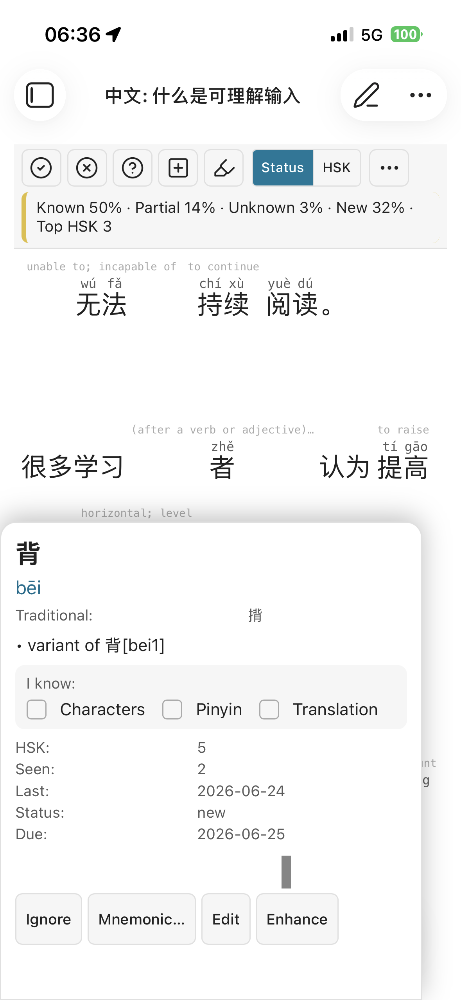
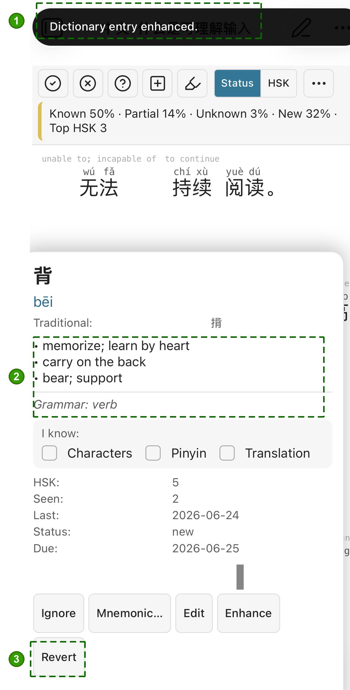

# OpenAI mode — setup, privacy, and cost

The OpenAI provider in Chinese Comprehensible Input is the "just works" path
to daily story generation: paste an API key and the plugin does the rest,
using **GPT-6 luna** under the hood (with the previous model, GPT-5.4 mini, one tap away). This page explains what that means
for your data, what it costs, and how to get an API key.

If you'd rather keep everything local, use the **Ollama** provider instead
— it runs on your own machine, no third party involved. The rest of this
document is only relevant if you've picked OpenAI.

---

## 1. What this mode does

When you generate a story (manually via Flashcards → Smart story, or
automatically once per day if you enable that), the plugin sends a prompt
to OpenAI's `chat/completions` endpoint and writes the returned Chinese
text to a note in your vault. The model is pinned to **GPT-6 luna** —
the efficient tier of OpenAI's newest family, and the cheapest one strong
enough for graded Chinese generation. You can't pick an arbitrary model, but
Settings → AI provider → **OpenAI model** lets you switch to the previous one,
**GPT-5.4 mini**, if the new model's text reads worse for you. If you want full
control over model and prompts, run Ollama.

A configured provider also unlocks **Enhance** on the word popup card: tap it
to enrich a sparse dictionary entry with fuller senses and grammar info.

&nbsp;

Before → after tapping **Enhance**: 1. a "Dictionary entry enhanced"
confirmation, 2. enriched definitions + grammar replacing the bare
"variant of…", and 3. a **Revert** button to undo it.

---

## 2. Privacy — your text leaves Obsidian

Every story generation sends the following to OpenAI's servers:

- The system prompt (a fixed instruction set in English).
- The list of **target words** the story should include (Chinese surface
  forms + pinyin + English glosses).
- Optionally, a sample of words you already know (only if
  `Send known words` is on in Story settings — off by default).
- On repair passes, the previous Chinese draft so the model can improve it.

The per-word AI actions send much less — one word each, plus at most the
sentence you tapped it in:

- **Enhance** — the word, its pinyin, its current dictionary definitions,
  and the sentence it appeared in.
- **Mnemonic** — the word, its pinyin, traditional form, HSK level and
  dictionary definitions; the sentence (when available); whatever is
  currently in the two mnemonic fields; and your own prompt template. The
  plugin adds a list of the word's characters with the tone of each and, for
  a word of several characters, a short dictionary gloss per character. If
  the answer breaks a rule, one follow-up request repeats this and lists the
  problem. Only sent when you press "Generate with AI". See
  [Mnemonics](./mnemonics.md).
- **Explain** — the word, its pinyin, traditional form, HSK level, its dictionary
  readings and definitions, one line per character (its pinyin and a short
  dictionary meaning), and the sentence you opened the card from, if any. One
  request, plus at most one follow-up when a rule was broken. Only sent when you
  press "Explain"; nothing is saved until you press Save. See
  [Explain](./explain.md).
- **Lightbulb (explain / proof read a phrase)** — only the **text you selected**, with the note's formatting
  taken off. Explain makes two requests (a quick check, then the explanation), Proof read one, plus at most one
  follow-up each when a rule was broken. A single word under Explain is sent as the word note above, with its
  sentence. The confirm dialog shows the text and the estimated cost before anything is sent. See
  [Explain](./explain.md).
- **Your own prompt text** — anything you wrote under Settings → AI provider → AI prompts (extra instructions, or a
  replacement for a whole prompt) is sent with the matching requests above, so keep it free of anything private.
- **Mnemonics for this note…** (the reader's ⋯ menu) — the same as a single
  Mnemonic request, once per word, for each word in the **open note** that
  has no mnemonic yet (or, if you choose Regenerate all, every word in scope)
  and is not known or ignored: the word, its pinyin,
  traditional form, HSK level, definitions, the **first sentence of that note
  in which the word appears**, and the character list above. The fields for an
  existing mnemonic are never sent, not even when you regenerate it. It
  shows you the number of words and an estimate of the cost, and asks you to
  confirm, before anything is sent. A note with many unknown words means many
  requests, one per word, plus the occasional follow-up.

OpenAI's API terms (as of writing) state that API requests are **not used
to train OpenAI's models**, and data is retained briefly for abuse
monitoring before being deleted. Even so: this is a third-party service.
If your notes contain anything you don't want passing through OpenAI's
infrastructure, don't use this mode.

The plugin never sends your full vault, your vocabulary database, or any
note content you didn't explicitly target. "Mnemonics for this note…" targets the
note you have open: it sends single sentences from that note, one with each
word, never the whole note in one piece and never any other note.

---

## 3. It costs money — but probably less than you think

OpenAI bills per token (roughly per word fragment). Pricing:

| What | GPT-6 luna (default) | GPT-5.4 mini (previous) |
|------|---------------------|-------------------------|
| Input, per 1M tokens | $0.10 | $0.75 |
| Cached input, per 1M tokens | $0.01 | $0.075 |
| Output, per 1M tokens | $0.50 | $4.50 |

A typical story generation breaks down like this:

| Component | Tokens (typical) |
|-----------|------------------|
| System prompt | ~250 input |
| User prompt with 12 target words | ~350 input |
| First-attempt output (~400 Chinese chars + JSON envelope) | ~600 output |
| One repair pass (average across 0–4 reps) | ~1500 input + ~600 output |
| **Per story (average)** | **~2100 input + ~1200 output** |

Math with the default model: `(2100 × 0.10 + 1200 × 0.50) / 1,000,000 ≈ $0.0008` per story
(about `$0.0070` on GPT-5.4 mini).

That works out to:

- **1 story per day → ~$0.025 / month, ~$0.30 / year** (GPT-5.4 mini: ~$0.21 / month).
- Worst case (full 4 repairs every call, known-words sample on, longer
  stories) stays well under **$1 / month**, on either model.

You can verify in real time: Settings → AI provider → OpenAI shows a
**Your usage** widget with rolling 24h / 7d / 30d token counts and the
exact dollar cost, each call billed at the price of the model that served it. Every successful call updates it. No nasty surprises.

---

## 4. Get an OpenAI API key

You only do this once.

1. Go to <https://platform.openai.com/home>. Sign up if you don't have
   an account.
2. Open **Settings → Billing** and click **Add to credit balance**. Add a
   payment method and pre-pay an amount you're comfortable with — even
   **$5 will last roughly two years** at the rates above.
3. **Turn off auto-recharge** if you want a hard ceiling. It's in
   **Settings → Billing → Auto recharge** — useful if you'd rather decide
   manually when to top up than let OpenAI re-bill your card.
4. Go to <https://platform.openai.com/settings/organization/api-keys>
   and click **Create new secret key**. Give it a name like
   `obsidian-chinese-plugin`. **Copy the key right away** — OpenAI shows
   it exactly once and you can't view it again after closing the dialog.

---

## 5. Paste the key into the plugin

In Obsidian → Settings → **Chinese Comprehensible Input** → AI provider:

1. Make sure **Provider** is set to **OpenAI**.
2. Paste the key into **OpenAI API key**.
3. Click **Test connection**. You should see "AI provider reachable."

If AI is switched on but no key is saved yet, every AI action (Explain, the lightbulb tool, Enhance, Generate with AI,
Mnemonics for this note, story generation) opens a short "Set up AI" dialog with an **Open settings** button instead of
failing; for Ollama the same applies while the server address is empty.

The key stays on this device only. It's written to Obsidian's per-vault
`localStorage` (via `app.saveLocalStorage`), **not** to `data.json` —
which means it's never copied into a vault sync (iCloud, Obsidian Sync,
remotely-save, etc.) and never lands in the settings-mirror or export
files. If you ever want to revoke it, delete the key on the OpenAI side
at the API-keys page above; the local copy becomes inert.

---

## 6. Verify end-to-end

Open the Stats view (left ribbon "中" icon → Flashcards tab) and click
**Generate story** under the Smart story panel. After a few seconds:

- A new note appears in your generated-stories folder.
- The **Your usage** widget ticks: input and output token counts go up,
  and the cost row shows a few cents.

If something fails, check the error notice and the developer console
(Cmd-Option-I on macOS). The most common cause is a typo in the key.

---

## See also

- [Documentation index](./index.md)
- [Frequently asked questions](./faq.md)
- [Ollama tips (the alternative provider)](./ollama-tips.md)
- [Story generation, end to end](./story-generation.md)
